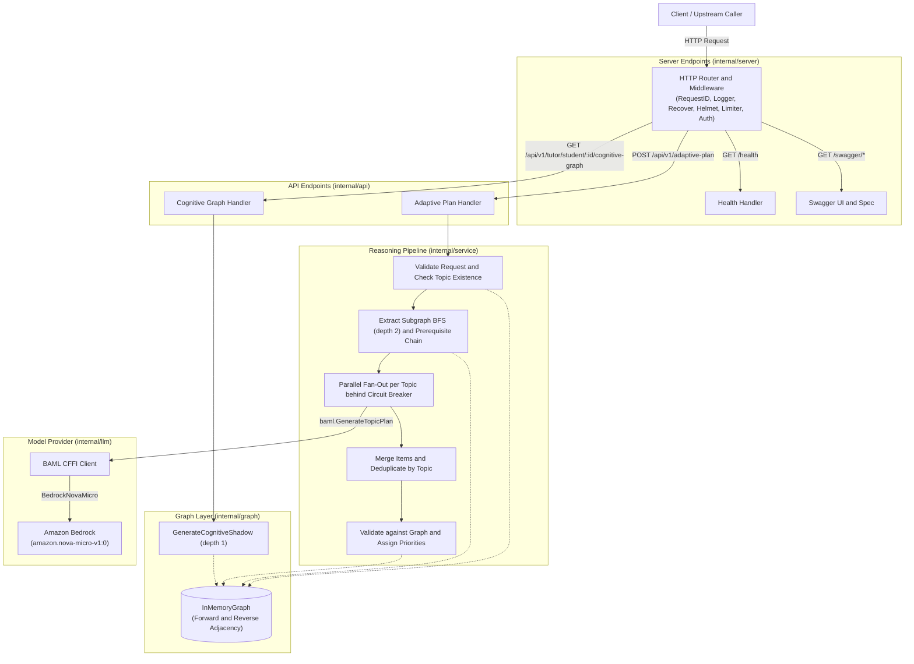

# AxiomEngine

[](https://github.com/Victoroide/axiom-engine/actions/workflows/ci.yml)
[](https://github.com/Victoroide/axiom-engine/actions/workflows/codeql.yml)
[](https://golang.org)
[](LICENSE)

AxiomEngine is a Go microservice that generates personalized, prerequisite-ordered adaptive study plans from student assessment deficits. It combines an in-memory curriculum knowledge graph with Amazon Bedrock model inference executed through a generated BAML client. The service exposes HTTP endpoints for study plan generation, cognitive shadow graph visualization, and system health checks.

## Features

- **Knowledge-graph guided reasoning**: Extracts prerequisite chains and local subgraphs using depth-first and breadth-first search over an immutable graph.
- **VARK-aligned resource mapping**: Generates study recommendations tailored to visual, auditory, read-write, or kinesthetic learning modalities.
- **Concurrent bounded fan-out**: Dispatches parallel per-topic LLM calls bounded per request and per process, with circuit breaker protection.
- **Hallucination validation**: Verifies model outputs against known graph nodes, dropping unrecognized concepts and concepts outside the requested topics and their prerequisites before assigning priorities.
- **Cognitive shadow graphs**: Computes graph neighborhoods classifying concepts into failed, learning, and mastered states for frontend visualization.
- **Configurable token authentication**: Restricts API access using constant-time verification of internal shared tokens.

## Request Path



## Quick Start

### Docker

1. Copy the example environment file:

```sh
cp .env.example .env
```

Generate an internal token (for example `openssl rand -hex 32`) and set `AXIOM_INTERNAL_TOKEN=<generated value>` in `.env`.

2. Build and run the container with Docker Compose:

```sh
docker compose up --build
```

The container starts with non-root UID/GID `65532:65532` and publishes port 8080 on loopback (`http://127.0.0.1:8080`).

### Local Development

Prerequisites: Go 1.27.3, CGO toolchain, and AWS credentials.

1. Set the required AWS credentials and service token:

```sh
export AWS_REGION=us-east-1
export AWS_ACCESS_KEY_ID="your-access-key-id"
export AWS_SECRET_ACCESS_KEY="your-secret-access-key"
export AXIOM_INTERNAL_TOKEN="$(openssl rand -hex 32)"
```

2. Start the application:

```sh
make run
```

Alternatively, build the binary with `make build` and run `./bin/axiom-server`.

The server binds `:8080`, accepting connections on all interfaces (`http://0.0.0.0:8080`). Interactive documentation is available at `http://127.0.0.1:8080/swagger/index.html`.

## Minimal API Examples

### Health Check

The health endpoint is unauthenticated and reports process liveness.

```sh
curl -i http://localhost:8080/health
```

Response:

```json
{"status":"ok"}
```

### Cognitive Shadow Graph

Inspect concept mastery and prerequisite states for a learner.

```sh
curl -i "http://localhost:8080/api/v1/tutor/student/student-42/cognitive-graph?topics=Polymorphism,Recursion" \
  -H "X-Internal-Token: $AXIOM_INTERNAL_TOKEN"
```

Response:

```json
{
  "nodes": [
    {"id": "Classes", "label": "Classes", "cognitive_state": "learning"},
    {"id": "Design Patterns", "label": "Design Patterns", "cognitive_state": "mastered"},
    {"id": "Dynamic Programming", "label": "Dynamic Programming", "cognitive_state": "mastered"},
    {"id": "Functions", "label": "Functions", "cognitive_state": "learning"},
    {"id": "Generics", "label": "Generics", "cognitive_state": "mastered"},
    {"id": "Inheritance", "label": "Inheritance", "cognitive_state": "learning"},
    {"id": "Interfaces", "label": "Interfaces", "cognitive_state": "mastered"},
    {"id": "Merge Sort", "label": "Merge Sort", "cognitive_state": "mastered"},
    {"id": "Polymorphism", "label": "Polymorphism", "cognitive_state": "failed"},
    {"id": "Recursion", "label": "Recursion", "cognitive_state": "failed"}
  ],
  "edges": [
    {"source": "Design Patterns", "target": "Interfaces", "relation": "depends_on"},
    {"source": "Design Patterns", "target": "Polymorphism", "relation": "depends_on"},
    {"source": "Dynamic Programming", "target": "Recursion", "relation": "depends_on"},
    {"source": "Generics", "target": "Polymorphism", "relation": "depends_on"},
    {"source": "Inheritance", "target": "Classes", "relation": "depends_on"},
    {"source": "Merge Sort", "target": "Recursion", "relation": "depends_on"},
    {"source": "Polymorphism", "target": "Inheritance", "relation": "depends_on"},
    {"source": "Recursion", "target": "Functions", "relation": "depends_on"}
  ]
}
```

### Adaptive Study Plan

Generate a personalized study plan for failed concepts.

```sh
curl -i -X POST http://localhost:8080/api/v1/adaptive-plan \
  -H "X-Internal-Token: $AXIOM_INTERNAL_TOKEN" \
  -H "Content-Type: application/json" \
  -d '{
    "student_id": "student-42",
    "course_id": "cs101",
    "failed_topics": ["Polymorphism"],
    "vark_profile": "visual"
  }'
```

Response:

```json
{
  "student_id": "student-42",
  "course_id": "cs101",
  "items": [
    {
      "topic": "Inheritance",
      "priority": 1,
      "prerequisite_chain": ["Classes", "Objects", "Variables"],
      "explanation": "Understanding class hierarchies is required before applying dynamic dispatch.",
      "resources": [
        {
          "title": "Visual Guide to Class Inheritance",
          "url": "https://example.com/inheritance-diagram",
          "resource_type": "diagram"
        }
      ]
    },
    {
      "topic": "Polymorphism",
      "priority": 2,
      "prerequisite_chain": ["Inheritance", "Classes", "Objects", "Variables"],
      "explanation": "Mastering method overriding and dynamic polymorphism allows flexible design.",
      "resources": [
        {
          "title": "Polymorphism Animation Walkthrough",
          "url": "https://example.com/polymorphism-video",
          "resource_type": "video"
        }
      ]
    }
  ],
  "_meta": {
    "subgraph_tuples": 8,
    "topics_processed": 1,
    "items_generated": 2,
    "items_after_validation": 2,
    "llm_latency_ms": 1120.0,
    "total_latency_ms": 1135.0
  }
}
```

## Documentation

| Document | Description |
|---|---|
| [Architecture](docs/architecture.md) | Package layout, component topology, sequence diagrams, resilience parameters, and design decisions |
| [API Reference](docs/api.md) | Authentication schemes, common headers, error envelopes, and endpoint specifications |
| [Configuration](docs/configuration.md) | Exhaustive environment variable table and AWS credential resolution mechanics |
| [Knowledge Graph](docs/knowledge-graph.md) | Subject-Relation-Object data model, relation semantics, seed graph, file schemas, and shadow computation |
| [Deployment](docs/deployment.md) | Multi-stage Docker build, non-root execution, compose configuration, and operating instructions |
| [Development](docs/development.md) | Prerequisites, make targets, BAML and Swagger generation, and test suite execution |

For project governance and contribution standards, refer to [CONTRIBUTING.md](CONTRIBUTING.md), [SECURITY.md](SECURITY.md), [CODE_OF_CONDUCT.md](CODE_OF_CONDUCT.md), and [CHANGELOG.md](CHANGELOG.md).

## License

This project is licensed under the MIT License. See [LICENSE](LICENSE) for details.
