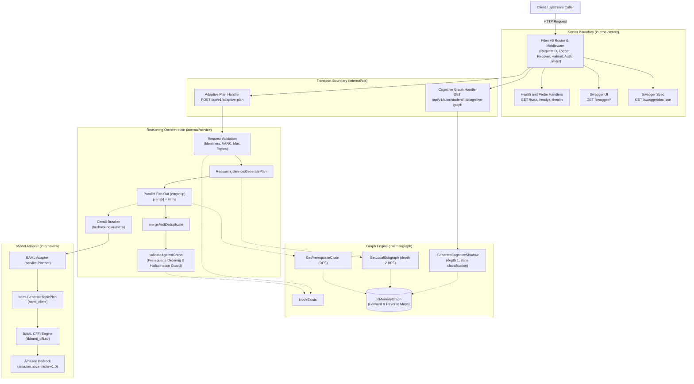
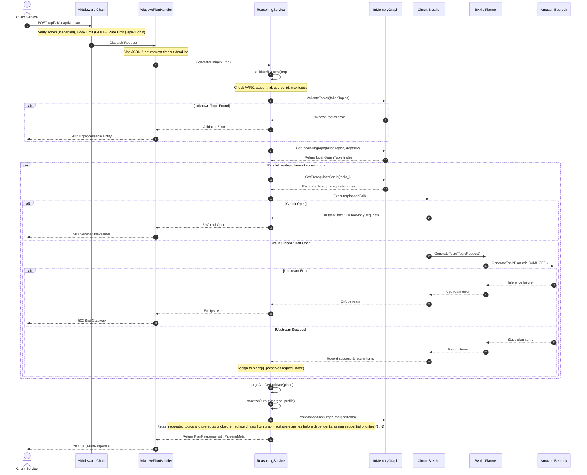

# Architecture

## System Components

AxiomEngine organizes responsibilities into distinct Go packages under `cmd/` and `internal/`, wired together at startup in `cmd/server/main.go`.

### Package Layout

| Package / Directory | Responsibility |
|---|---|
| `cmd/server` | Entry point, healthcheck command, configuration loading, graph initialization, signal handling, and server execution. |
| `internal/api` | HTTP handler registration, request binding, parameter validation, and status code translation. |
| `internal/config` | Environment variable parsing, validation bounds, and fallback defaults. |
| `internal/domain` | Canonical data transfer objects (DTOs), API models, graph tuples, telemetry structures, and error envelopes. |
| `internal/graph` | In-memory directed knowledge graph, forward and reverse adjacency indexes, seed loader, BFS subgraph extraction, DFS prerequisite chains, and cognitive shadow computation. |
| `internal/llm` | Adapter converting domain structures to and from generated BAML types and invoking model execution. |
| `internal/server` | Fiber v3 application initialization, middleware chain, private Swagger spec registration, and graceful shutdown lifecycle. |
| `internal/service` | Reasoning orchestration pipeline, input validation, circuit breaker wrapping, parallel topic fan-out, item deduplication, and hallucination filtering. |
| `baml_client` | Generated Go client code for Boundary ML BAML model invocations and data types. |
| `baml_src` | BAML schema templates, prompt functions, and client configuration for Amazon Bedrock. |
| `docs` | Swagger 2.0 specifications (`swagger.json`, `swagger.yaml`), generated Go doc registration, and technical documentation. |
| `test/e2e` | Headless browser end-to-end tests using Go and Rod verifying Swagger UI operations and interactive execution. |

---

## Adaptive Plan Sequence

The `POST /api/v1/adaptive-plan` endpoint executes a multi-stage reasoning pipeline that combines graph traversal, parallel LLM inference, and graph-guided output validation.

### Pipeline Execution Stages

1. **Request Binding and Validation**: Incoming JSON is decoded. The handler validates that `failed_topics` is non-empty and contains at most `MAX_FAILED_TOPICS` unique items (`internal/service/validation.go`). `vark_profile` is checked against allowed values (`visual`, `auditory`, `read_write`, `kinesthetic`). `student_id` and `course_id` are validated against `^[A-Za-z0-9._:-]{1,128}$` when provided (`internal/service/validation.go`).
2. **Topic Existence Verification**: All topics in `failed_topics` are verified against the in-memory graph (`internal/service/validation.go`). If any topic is absent from the graph, execution stops immediately and returns HTTP 422 `validation_error` with the list of unknown topics.
3. **Subgraph Extraction**: The service extracts a depth-2 bidirectional subgraph centered on the failed topics using breadth-first search (`GetLocalSubgraph` in `internal/graph/memory.go`). This context bounds the concept neighborhood provided to the LLM.
4. **Parallel Topic Fan-Out**: An `errgroup.Group` spawns a goroutine for each failed topic (`internal/service/reasoning.go`). Each goroutine:
   - Acquires a permit from the process-wide weighted semaphore (`LLM_MAX_CONCURRENCY`) within `LLM_QUEUE_TIMEOUT`; if the wait expires, returns HTTP 503 `service_unavailable` with `Retry-After: 1`.
   - Computes the topological prerequisite chain for its topic via post-order depth-first search (`GetPrerequisiteChain` in `internal/graph/memory.go`). Cyclic inputs are rejected at load time; the traversal visited set handles shared prerequisites.
   - Executes through a shared circuit breaker with an individual timeout bounded by `LLM_TIMEOUT` (`internal/service/reasoning.go`; see [Timeouts](#timeouts)).
   - Invokes Amazon Bedrock through the BAML adapter (`internal/llm/baml.go`) using `TopicRequest` (containing graph context, target topic, prerequisite order, and VARK profile, without learner identifiers). The generated BAML function returns study items. If the model output contains no usable item for the topic, the service emits a `stage.validation` warning log with `topic` and returns `ErrInvalidOutput`, which is excluded from circuit breaker failure counts.
   - Stores the generated items directly into `plans[i]`, where `i` is the original request index. This ensures deterministic ordering regardless of goroutine completion timing.
5. **Merge and Deduplication**: `mergeAndDeduplicate` in `internal/service/pipeline.go` iterates sequentially through the per-topic results in request order, tracking visited topic names in a map and dropping duplicate concept recommendations.
6. **Output Policy Enforcement**: `sanitizeOutput` in `internal/service/output.go` enforces the resource URL, text sanitization, length bounds, and VARK type policies before graph validation (see [response contract](api.md#response-contract)). If any resources are dropped, the service emits a WARN log record (`stage.output`) with `request_id` and `resources_dropped`.
7. **Prerequisite Ordering and Hallucination Validation**: `validateAgainstGraph` in `internal/service/pipeline.go` verifies every study item against the knowledge graph, retaining only requested canonical topics and their transitive prerequisites (`GetPrerequisiteChain`). Non-existent topics and items outside this closure are dropped. When items are dropped, the service emits a WARN log record with `request_id` and `items_dropped`. If any requested topic lacks a corresponding item after validation, the service emits a WARN log record with `request_id` and `topic` and returns `ErrInvalidOutput`, which maps to HTTP 502 `bad_gateway`. Each validated item receives its trusted prerequisite chain from the graph (`GetPrerequisiteChain`) rather than accepting invented planner chains. Validated items are stable-sorted by graph prerequisite rank so that prerequisite concepts always precede dependent concepts, preserving deterministic traversal order among independent topics. Sequential priorities (1, 2, 3...) are assigned after sorting.
8. **Response Construction**: The final `domain.PlanResponse` is assembled with `student_id` and `course_id` echoed directly from the original HTTP request envelope, validated and sorted study items, and internal telemetry metrics (`subgraph_tuples`, `topics_processed`, `items_generated`, `items_after_validation`, `items_dropped`, `llm_latency_ms`, `total_latency_ms`).

### Prompt Inputs

Upstream model inference isolates learner identity from prompt construction. When `ReasoningService` executes per-topic fan-out, `TopicRequest` supplies four inputs to the BAML adapter and Bedrock:
- `graph_context`: Subgraph concept triples (`GraphTuple[]`) centered on the target topic.
- `target_topic`: The target failed concept being evaluated.
- `prerequisite_order`: Topological prerequisite ordering computed from the knowledge graph.
- `vark_profile`: The requested VARK learning style (`visual`, `auditory`, `read_write`, or `kinesthetic`).

`TopicRequest` excludes learner identifiers (`student_id` and `course_id`), and BAML `GenerateTopicPlan` returns only `items`. Because response construction correlates `student_id` and `course_id` directly from the incoming HTTP request payload, upstream responses require neither identifier. Omitting learner identifiers upstream prevents schema validation parsing failures and HTTP 502 `bad_gateway` responses when upstream responses lack identifier fields. External HTTP request and response schemas and status mappings remain unchanged (see [Security Policy](../SECURITY.md#data-handling)).

---

## Resilience and Operational Limits

| Mechanism | Configuration Key | Default Value | Config Location | Implementation Location | Behavior |
|---|---|---|---|---|---|
| Transport Read Timeout | N/A | `10s` | Hardcoded in `internal/config/config.go` | `fiber.Config.ReadTimeout` in `internal/server/server.go` | Bounds duration for reading inbound request headers and body. |
| Transport Write Timeout | N/A | `30s` (derived) | Derived as `REQUEST_TIMEOUT + 10s` in `internal/config/config.go` | `fiber.Config.WriteTimeout` in `internal/server/server.go` | Bounds duration for transmitting HTTP responses. Derived write duration rejects overflow at startup (see [Timeouts](#timeouts)). |
| Transport Idle Timeout | N/A | `1m` | Hardcoded in `internal/config/config.go` | `fiber.Config.IdleTimeout` in `internal/server/server.go` | Bounds maximum idle keep-alive connection time. |
| Request Timeout | `REQUEST_TIMEOUT` | `20s` | `internal/config/config.go` | `AdaptivePlanHandler` in `internal/api/handlers.go` | Bounds total HTTP request processing duration in the reasoning pipeline. Exceeding returns 504 `gateway_timeout`. |
| LLM Timeout | `LLM_TIMEOUT` | `15s` | `internal/config/config.go` | `ReasoningService` in `internal/service/reasoning.go` | Bounds individual model calls. Validated at startup not to exceed `REQUEST_TIMEOUT` (see [Timeouts](#timeouts)). |
| LLM Concurrency Bound | `LLM_MAX_CONCURRENCY` | `16` | `internal/config/config.go` | `ReasoningService` in `internal/service/reasoning.go` | Process-wide weighted semaphore bounding simultaneous in-flight Bedrock calls across all requests. |
| LLM Queue Timeout | `LLM_QUEUE_TIMEOUT` | `min(2s, LLM_TIMEOUT/2)` | `internal/config/config.go` | `ReasoningService` in `internal/service/reasoning.go` | Maximum wait duration for an available concurrency slot (see [configuration](configuration.md#environment-variables)). Queue saturation returns HTTP 503 `service_unavailable` with `Retry-After: 1`. |
| Shutdown Timeout | `SHUTDOWN_TIMEOUT` | `max(REQUEST_TIMEOUT + 5s, 11s)` | `internal/config/config.go` | `Run` in `internal/server/lifecycle.go` | Maximum time allowed to drain connections during SIGINT or SIGTERM (minimum `11s`, see [configuration](configuration.md#environment-variables)); cancels in-flight work 1 s before the deadline and answers it with 503 `server shutting down`. |
| Healthcheck Timeout | N/A | `3s` | Hardcoded | `Healthcheck` in `internal/server/lifecycle.go` | Local CLI health check probe HTTP client deadline. |
| Circuit Breaker | N/A | Settings below | Hardcoded | `ReasoningService` in `internal/service/reasoning.go` | Wraps all model calls using `sony/gobreaker/v2`. Protects upstream Bedrock during failures. |
| Rate Limiting | `RATE_LIMIT_MAX`, `RATE_LIMIT_WINDOW` | `50` requests per `1m` | `internal/config/config.go` | `limiter.New` in `internal/server/server.go` | Sliding window IP rate limiter mounted at `/api/v1`. `/livez`, `/readyz`, `/health`, `/swagger/*` and, when `METRICS_ENABLED=true`, `/metrics` are excluded. Exceeding returns 429 `rate_limit_exceeded`. |
| Request Body Limit | N/A | `64 KiB` (65,536 bytes) | Hardcoded | `fiber.Config.BodyLimit` in `internal/server/server.go` | Fiber application body limit. Exceeding returns 413 `payload_too_large`. |
| Max Failed Topics | `MAX_FAILED_TOPICS` | `10` | `internal/config/config.go` | `validateRequest` in `internal/service/validation.go` | Bounds parallel fan-out concurrency. Exceeding returns 400 `validation_error`. |
| Upstream Retries | `AWS_MAX_ATTEMPTS`, `AWS_RETRY_MODE` | `3`, `standard` | Validated at startup; evaluated by AWS SDK | AWS SDK in BAML CFFI runtime | Single retry layer managed by the AWS SDK (see [Upstream Retries](#upstream-retries)). |

### Timeouts

HTTP transport timeouts configured on Fiber (`ReadTimeout`, `WriteTimeout`, `IdleTimeout`) operate at the socket layer. Fasthttp arms `WriteTimeout` only after request handler execution completes, so transport write timeouts do not bound active handler execution.

The reasoning service enforces deadlines autonomously:
- **Request Deadline**: Handlers enforce `REQUEST_TIMEOUT` (default `20s`) using context deadlines. Exceeding this limit returns HTTP 504 `gateway_timeout`.
- **LLM Deadline**: Model invocations are bounded by `LLM_TIMEOUT` (default `15s`). The service dispatches `planner.GenerateTopic` in a separate goroutine and selects concurrently on `llmCtx.Done()`. Even if downstream planner execution blocks indefinitely without checking context cancellation, the service unblocks immediately when the deadline expires and returns `context.DeadlineExceeded`, which maps to HTTP 504 `gateway_timeout`.
- **Concurrency Permit Retention**: When an LLM call times out or context is canceled, the dispatched goroutine continues running in the background until the underlying planner call completes or terminates. The goroutine retains its semaphore permit from `LLM_MAX_CONCURRENCY` until it actually finishes, preventing abandoned or runaway calls from evading process-wide concurrency limits.

### Circuit Breaker Settings

A single circuit breaker is instantiated with name `"bedrock-nova-micro"` in `internal/service/reasoning.go` and shared across topics and callers within each service instance because Bedrock availability and throttling affect the common backend:
- **Consecutive Failures Threshold (`ReadyToTrip`)**: Trips to the Open state after 3 consecutive failures (`c.ConsecutiveFailures >= 3`).
- **Open Duration (`Timeout`)**: Stays Open for `15s` before transitioning to Half-Open.
- **Half-Open Concurrency (`MaxRequests`)**: Permits 2 trial requests in Half-Open state.
- **Closed Interval (`Interval`)**: Clears internal counters every `30s` in Closed state.
- **Exclusion Predicate (`IsExcluded`)**: Configured with `IsExcluded: func(err error) bool { return errors.Is(err, context.Canceled) || errors.Is(err, ErrInvalidOutput) || errors.Is(err, ErrUpstreamRejected) }`. Direct and wrapped `context.Canceled`, `ErrInvalidOutput`, and `ErrUpstreamRejected` errors are excluded. Excluded errors count as neither success nor failure and cannot open or close the circuit; in Half-Open state, excluded errors release trial probe capacity without counting toward successful recovery. Invalid output describes unusable responses (such as parse failures, response truncation, or missing study items for requested topics), and rejected requests describe client-side rejections (including HTTP 4xx errors, credentials, and request validation failures); neither indicates backend unavailability. Excluding them prevents request-specific failures from tripping the shared circuit while retaining protection against shared backend outages. Availability failures—including `ErrThrottled` (HTTP 429), `ErrUpstreamUnavailable` (HTTP 5xx, HTTP 408, transport drops), and `context.DeadlineExceeded`—continue to count as failures that trip the breaker.

### Upstream Retries

BAML configures no application-level retry policy; retries are owned exclusively by the embedded AWS SDK. When operating in standard mode with default settings (`AWS_MAX_ATTEMPTS=3`, `AWS_RETRY_MODE=standard`), sustained upstream throttling (HTTP 429) results in three total attempts before returning `service.ErrThrottled`. Client-side rejections (such as HTTP 403 `AccessDeniedException`) and invalid model outputs fail on the initial attempt without retry loops. For environment variable settings, see [Configuration](configuration.md#environment-variables).

### Error Handling

The service classifies upstream model failures from Boundary ML (BAML) into typed sentinel errors in `internal/llm/classify.go`. Each sentinel error is defined in `internal/service/errors.go` and wraps `service.ErrUpstream`:

- `service.ErrThrottled`: Upstream rate limiting or capacity exhaustion (HTTP status code 429 or `ThrottlingException`).
- `service.ErrUpstreamUnavailable`: Server-side failures (HTTP 5xx status codes), dispatch or transport drop errors (`DispatchFailure`, connection reset, connection refused), client code 2, or timeouts (`TimeoutError`, HTTP 408).
- `service.ErrUpstreamRejected`: Upstream client-side rejections other than throttling (HTTP 4xx status codes like 400, 401, 403, 404, 424, or SDK exceptions like `AccessDeniedException` or `ValidationException`). BAML formats upstream HTTP 400 errors as `InvalidAuthentication (401)`.
- `service.ErrInvalidOutput`: Unusable model output, including malformed 2xx payloads, parsing errors (`Parsing error:`), schema validation errors (`Validation error:`, `ValidationError`), response truncation (`Finish reason error:` from `max_tokens` deny list), or missing study items for requested topics.

Classified errors wrap `service.ErrUpstream` via `fmt.Errorf("%w: %w", class, err)`. This preserves the underlying error for inspection with `errors.Is`. Unrecognized errors and `AbortError` strings pass through without extra classification.

#### HTTP Status Mapping

`ErrUpstreamUnavailable`, `ErrUpstreamRejected` and `ErrInvalidOutput` map to HTTP 502 `bad_gateway`. `ErrThrottled` maps to HTTP 503 `service_unavailable` with details `upstream throttled` and `Retry-After: 5`. When `ErrInvalidOutput` is returned, the response details indicate `model returned no usable item`; other upstream failures return `upstream reasoning failed`. When `ctx.Err()` is present upon return from the adapter, it returns `ctx.Err()` directly, producing HTTP 504 `gateway_timeout` when execution deadlines expire. For complete error codes, status mappings, and client-facing response schemas, see the [API reference](api.md#error-codes-and-http-statuses).

---

## Observability

The service uses an isolated, private Prometheus registry instantiated per application instance (`internal/metrics/metrics.go`). When metrics are disabled (`METRICS_ENABLED=false`, see [configuration](configuration.md)), collectors are not allocated and no metrics overhead is incurred.

HTTP request metrics match only registered route templates rather than raw request paths, preventing label cardinality explosion from unknown or malformed paths. Requests rejected by authentication or rate limiting are still counted under their registered route template. Metrics never record raw URLs, query parameters, authorization tokens, learner identifiers, or error messages as labels.

The following Prometheus metrics are exposed:

- `http_server_requests_total{route,method,status}`: Counter recording requests matching registered endpoints, including authentication and rate-limiting responses. The `route` label records the parameterized Fiber route template (e.g. `/api/v1/tutor/student/:student_id/cognitive-graph`), `method` records the registered HTTP method or `unmatched`, and `status` records the numeric HTTP response status code. Requests that match no route (404, 405) are counted under the fixed labels `route="unmatched"` and `method="unmatched"`; raw paths never become labels.
- `http_server_request_duration_seconds{route}`: Histogram recording HTTP request latency in seconds by route template. The histogram sample count supplies per-route request volume. Requests matching no registered route are counted under `route="unmatched"`. Buckets are `0.05, 0.1, 0.25, 0.5, 1, 2, 4, 8, 12, 16, 20, 30` seconds.
- `axiom_auth_previous_token_total`: Counter of `/api/v1` requests authenticated with `AXIOM_INTERNAL_TOKEN_PREVIOUS`. It stays at 0 when no previous token is configured.
- `axiom_llm_calls_total{outcome}`: Counter recording dispatched upstream planner calls by classified outcome. Fixed outcomes are `ok`, `throttled`, `unavailable`, `rejected`, `invalid_output`, `deadline`, `canceled`, and `error`. Missing usable output for a requested topic is recorded as `invalid_output`. Queue rejections and calls blocked by an open circuit breaker do not dispatch upstream calls and are excluded from these counts.
- `axiom_llm_duration_seconds{outcome}`: Histogram recording dispatched upstream call duration in seconds until completion or enforced deadline cancellation. Buckets are `0.05, 0.1, 0.25, 0.5, 1, 2, 4, 8, 12, 16, 20, 30` seconds.
- `axiom_llm_inflight`: Gauge tracking upstream calls currently executing, including calls executing past their response deadline. Concurrency semaphore permits remain occupied until execution finishes.
- `axiom_llm_queue_wait_seconds`: Histogram measuring admission wait duration for an available concurrency slot, including canceled and timed-out waits. Buckets are `0.001, 0.005, 0.01, 0.025, 0.05, 0.1, 0.25, 0.5, 1, 2, 5` seconds.
- `axiom_llm_queue_timeouts_total`: Counter recording concurrency queue waits that exhausted `LLM_QUEUE_TIMEOUT`, excluding parent cancellation or request deadline expiration.
- `axiom_circuit_breaker_state`: Gauge function evaluated dynamically on scrape returning current circuit breaker state: `0` (closed), `1` (half-open), `2` (open).
- `axiom_plan_items_dropped_total{reason}`: Counter recording plan items removed during pipeline processing. Fixed `reason` labels are `duplicate` (removed during merge deduplication) and `validation` (removed because topics were unknown to the graph or outside the requested prerequisite closure).
- `axiom_plan_resources_dropped_total`: Counter recording recommended study resources removed by output policy validation.
- Go runtime (`go_*`) and process (`process_*`) series: Standard Go runtime collectors and process collectors from the private registry, the latter only where supported by the operating system platform.

---

## Design Decisions

- **In-memory graph storage**: The curriculum knowledge graph contains 20 tuples in seed data and fits entirely in memory. Maintaining forward and reverse adjacency maps in Go memory provides sub-millisecond BFS and DFS traversal without external database infrastructure or network overhead.
- **Fiber v3 web framework**: Fiber provides high-throughput routing with low memory allocations, built-in security middlewares (helmet, limiter, cors, recover, requestid), and standard context propagation.
- **Decoupled Planner interface**: `service.ReasoningService` depends on the `service.Planner` interface rather than directly on generated BAML functions. This allows unit and race tests to run deterministically with mock planners without requiring AWS credentials or network access.
- **Typed upstream error classification**: BAML Go returns runtime failures as unclassified string messages (`BamlError`). `internal/llm/classify.go` inspects upstream error messages and wraps them in typed sentinels (`ErrThrottled`, `ErrUpstreamUnavailable`, `ErrUpstreamRejected`, `ErrInvalidOutput`) that each wrap `service.ErrUpstream`. Downstream logic and tests can distinguish error categories using `errors.Is` while preserving existing HTTP status mapping.
- **Indexed slot assignment during fan-out**: Parallel goroutines write directly to pre-allocated slice indices (`plans[i] = items`). This prevents race conditions and ensures that curriculum item priorities depend solely on request topic order rather than goroutine completion speed.
- **Circuit breaker exclusion handling**: A single circuit breaker protects the shared Bedrock backend across all topics and callers. Sibling errgroup cancellations produce `context.Canceled`, unusable model responses produce `ErrInvalidOutput` (including missing items for requested topics), and client rejections produce `ErrUpstreamRejected`. Using `IsExcluded` in `gobreaker` ensures cancellations, invalid output, and rejected requests (direct or wrapped) are treated neutrally (neither success nor failure), and trial probes in half-open state are released without recording recovery. This prevents request-specific validation or parsing failures and client 4xx rejections from tripping the shared circuit and blocking unrelated topics, while preserving failure counting for genuine backend availability degradation (`ErrThrottled`, `ErrUpstreamUnavailable`, and `context.DeadlineExceeded`).
- **Server-enforced prerequisite ordering**: Included study prerequisites are ordered ahead of dependents based on knowledge graph topological order, regardless of request or planner order; independent topics retain deterministic traversal ordering. In addition, `prerequisite_chain` is populated using `graph.GetPrerequisiteChain` rather than trusted from the planner.
- **Bounded failure logging**: Request failure logging bounds error summaries to `error_class`, `request_id`, and when known, `topic` capped at 128 characters, omitting raw upstream prompts and provider error payloads. `stage.validation` logs WARN records with `request_id` and `items_dropped` when items outside the allowed closure are dropped, and with `request_id` and `topic` when a requested topic has no usable item.
- **Post-generation hallucination filtering**: LLM responses may invent topic names not present in the curriculum. The `validateAgainstGraph` stage filters out non-existent topics before assigning priorities, maintaining graph integrity.
- **Private Swagger specification copy**: `swag.Spec.ReadDoc()` mutates its receiver during template evaluation. AxiomEngine clones the private specification structure at startup and serves the evaluated JSON statically, eliminating data races during concurrent documentation requests.
