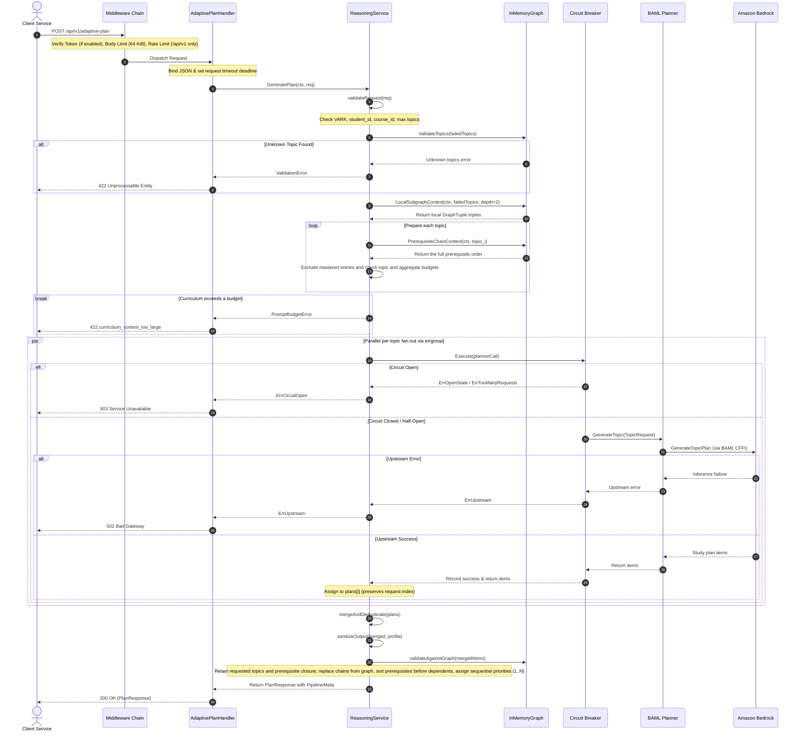

# Architecture

## System Components

AxiomEngine organizes responsibilities into distinct Go packages under `cmd/` and `internal/`, wired together at startup in `cmd/server/main.go`.

<picture>
  <source media="(prefers-color-scheme: dark)" srcset="assets/diagrams/system-components-dark.svg">
  
</picture>

The diagram shows package imports in layers. An arrow is drawn only when no longer chain of arrows already implies the import, so following the arrows reaches every package a package imports. From `cmd/server`, HTTP requests go through `internal/server` and `internal/api` to `internal/service`; `internal/mcpserver` and the model adapter `internal/llm` also import the service, and `internal/llm` imports `baml_client`. The HTTP server uses `internal/auth` for verified access tokens. `internal/api` imports `internal/idempotency`, and `internal/service` imports `internal/graph` and `internal/metrics`. `internal/config`, `internal/telemetry` and `internal/domain` are imported throughout and appear as a band without arrows. Motion follows `cmd/server` through `internal/server`, `internal/api` and `internal/service` to `internal/graph`.

### Package Layout

| Package / Directory | Responsibility |
|---|---|
| `cmd/server` | Entry point, healthcheck command, configuration loading, graph initialization, signal handling, and server execution. |
| `internal/api` | HTTP handler registration, request binding, parameter validation, and status code translation. |
| `internal/auth` | [Access token verifier](development.md#access-token-verifier) for a configured issuer and resource audience. |
| `internal/config` | Environment variable parsing, validation bounds, and fallback defaults. |
| `internal/domain` | Canonical data transfer objects (DTOs), API models, graph tuples, telemetry structures, and error envelopes. |
| `internal/graph` | In-memory directed knowledge graph, forward and reverse adjacency indexes, seed loader, BFS subgraph extraction, DFS prerequisite chains, and cognitive shadow computation. |
| `internal/idempotency` | Idempotency key reservation lifecycle, TTL expiration, in-memory bounded store, and distributed Redis storage. |
| `internal/llm` | Adapter converting domain structures to and from generated BAML types and invoking model execution using a dynamic client registry across supported providers. |
| `internal/server` | Fiber v3 application initialization, middleware chain, private Swagger spec registration, and graceful shutdown lifecycle. |
| `internal/service` | Reasoning orchestration pipeline, input validation, circuit breaker wrapping, parallel topic fan-out, item deduplication, and hallucination filtering. |
| `baml_client` | Generated Go client code for Boundary ML BAML model invocations and data types. |
| `baml_src` | BAML schema templates, prompt functions, and client configuration for Amazon Bedrock. |
| `docs` | Swagger 2.0 specifications (`swagger.json`, `swagger.yaml`), generated Go doc registration, and technical documentation. |
| `test/e2e` | Headless browser end-to-end tests using Go and Rod verifying Swagger UI operations and interactive execution. |

---

## Adaptive Plan Sequence

The `POST /api/v1/adaptive-plan` endpoint executes a multi-stage reasoning pipeline that combines graph traversal, parallel LLM inference, and graph-guided output validation.

### Pipeline Execution Stages

1. **Request Binding and Validation**: Incoming JSON is decoded. The handler validates that `failed_topics` is non-empty and contains at most `MAX_FAILED_TOPICS` unique items, and that optional `mastered_topics` contains at most `MAX_MASTERED_TOPICS` unique items (`internal/service/validation.go`). If any topic appears in both `failed_topics` and `mastered_topics`, the request is rejected with HTTP 400 `validation_error`. `vark_profile` is checked against allowed values (`visual`, `auditory`, `read_write`, `kinesthetic`). `student_id` and `course_id` are validated against `^[A-Za-z0-9._:-]{1,128}$` when provided (`internal/service/validation.go`).
2. **Topic Existence Verification**: All topics in `failed_topics` and `mastered_topics` are verified against the in-memory graph (`internal/service/validation.go`). If any topic is absent from the graph, execution stops immediately and returns HTTP 422 `validation_error` with the list of unknown topics.
3. **Curriculum preparation** extracts one depth-two bidirectional neighborhood for all failed topics, including edges touching depth-two nodes. It computes each topic's full prerequisite chain in post-order and removes mastered entries from the order sent upstream. The service checks the [curriculum prompt budget](configuration.md#curriculum-prompt-budget) across all prepared topic inputs before starting any call.
4. **Parallel Topic Fan-Out**: An `errgroup.Group` spawns a goroutine for each failed topic (`internal/service/reasoning.go`). Each goroutine:
   - Acquires a permit from the process-wide weighted semaphore (`LLM_MAX_CONCURRENCY`) within `LLM_QUEUE_TIMEOUT`; if the wait expires, returns HTTP 503 `service_unavailable` with `Retry-After: 1`.
   - Checks the shared circuit breaker before dispatch. `LLM_TIMEOUT` bounds the wait for the planner result. See [Timeouts](#timeouts).
   - Invokes Amazon Bedrock through the BAML adapter (`internal/llm/baml.go`) using `TopicRequest` (containing graph context, target topic, prerequisite order, and VARK profile, without learner identifiers). The generated BAML function returns study items. If the model output contains no usable item for the topic, the service emits a `stage.validation` warning log with `topic` and returns `ErrInvalidOutput`, which is excluded from circuit breaker failure counts.
   - Stores the generated items directly into `plans[i]`, where `i` is the original request index. This ensures deterministic ordering regardless of goroutine completion timing. When configured with `service.WithProgress`, the service invokes the progress callback concurrently as each topic completes, delivering `domain.TopicProgress` with topic name, request index, and generated item count without leaking state across calls.
5. **Merge and Deduplication**: `mergeAndDeduplicate` in `internal/service/pipeline.go` iterates sequentially through the per-topic results in request order, tracking visited topic names in a map and dropping duplicate concept recommendations.
6. **Output Policy Enforcement.** `sanitizeOutput` in `internal/service/output.go` enforces URL, text, length, and VARK resource policies before graph validation. When output policy drops resources, the service emits a WARN log record (`stage.output`) with `request_id` and `resources_dropped`. With `RESOURCE_LINK_CHECK=true`, both HTTP plan routes and the stdio MCP `generate_study_plan` tool check links after sanitization. Each server's checker shares eight permits across plan requests and checks each distinct sanitized URL once per request. The budget (`RESOURCE_LINK_TIMEOUT`, default `3s`) includes time in the queue, hostname resolution, `HEAD`, fallback `GET` with `Range: bytes=0-0` on 405 or 501, and up to three redirects across both methods. A status that arrives after the budget expires counts as a timeout. A permit stays occupied until hostname resolution, dialing, and socket cleanup finish. The caller can return on cancellation while the system resolver completes its lookup, and a canceled check skips connection attempts after resolution returns. Checks use no environment proxy, cookies, or credentials, identify as `User-Agent: axiom-engine`, and allow `http` and `https` on ports 80 and 443. The dialer validates resolved socket addresses at each connection and redirect, refusing non-public IPv4, IPv6, mapped IPv4, and special-purpose or translation addresses. Each removed occurrence increments `_meta.resources_unreachable`. See the [response contract](api.md#response-contract).
7. **Prerequisite Ordering and Hallucination Validation**: `validateAgainstGraph` in `internal/service/pipeline.go` verifies every study item against the knowledge graph, retaining only requested canonical topics and their transitive prerequisites (`GetPrerequisiteChain`). Non-existent topics, items outside this closure, and generated items matching mastered topics are dropped. When items are dropped, the service emits a WARN log record with `request_id` and `items_dropped`. If any requested topic lacks a corresponding item after validation, the service emits a WARN log record with `request_id` and `topic` and returns `ErrInvalidOutput`, which maps to HTTP 502 `bad_gateway`. Each validated item receives its trusted prerequisite chain from the graph (`GetPrerequisiteChain`) rather than accepting invented planner chains. Validated items are stable-sorted by graph prerequisite rank so that prerequisite concepts always precede dependent concepts, preserving deterministic traversal order among independent topics. Sequential priorities (1, 2, 3...) are assigned after sorting.
8. **Response Construction**: The final `domain.PlanResponse` is assembled with `student_id` and `course_id` echoed directly from the original HTTP request envelope, validated and sorted study items, and internal telemetry metrics (`subgraph_tuples`, `topics_processed`, `items_generated`, `items_after_validation`, `items_dropped`, `items_skipped_mastered` when non-zero, `resources_unreachable` when non-zero, `llm_latency_ms`, `total_latency_ms`).

### Streaming Plan Generation

The streaming endpoint `POST /api/v1/adaptive-plan/stream` (`internal/api/stream.go`) exposes pipeline execution progress over Server-Sent Events (SSE):
- The streaming endpoint validates and prepares the plan before starting the SSE stream. Any preparation failure returns a standard JSON error envelope. The stream dispatches the prepared inputs after its initial keepalive.
- **Event buffer**: Request context values and strings are cloned before asynchronous execution. The stream writer buffers completed topic notifications via a bounded per-request channel sized to the number of failed topics.
- The stream writes an initial `: keepalive` comment followed by periodic keepalives every 2 seconds. The first write or flush failure cancels the pipeline context. The service stops waiting for planner results, and each dispatched call holds its permit until the planner returns or unwinds after a panic.
- **Final output**: Successful pipeline completion emits an `event: plan` frame carrying the validated `domain.PlanResponse` assembled through the shared merge, sanitization, and graph validation stages. Pipeline errors emit `event: error` carrying the error envelope and equivalent numeric HTTP status.

### Prompt Inputs

Upstream model inference isolates learner identity from prompt construction. When `ReasoningService` executes per-topic fan-out, `TopicRequest` supplies four inputs to the BAML adapter and Bedrock:
- `graph_context` contains the shared neighborhood triples (`GraphTuple[]`) around all failed topics.
- `target_topic`: The target failed concept being evaluated.
- `prerequisite_order`: Topological prerequisite ordering computed from the knowledge graph, excluding mastered concepts.
- `vark_profile`: The requested VARK learning style (`visual`, `auditory`, `read_write`, or `kinesthetic`).

`TopicRequest` excludes learner identifiers (`student_id` and `course_id`), and BAML `GenerateTopicPlan` returns only `items`. Because response construction correlates `student_id` and `course_id` directly from the incoming HTTP request payload, upstream responses require neither identifier. Omitting learner identifiers upstream prevents schema validation parsing failures and HTTP 502 `bad_gateway` responses when upstream responses lack identifier fields. Mastered prerequisites are filtered out from `prerequisite_order` before dispatch while `graph_context` retains the full local graph and returned items retain their complete graph prerequisite chains.

---

## Resilience and Operational Limits

| Mechanism | Configuration Key | Default Value | Config Location | Implementation Location | Behavior |
|---|---|---|---|---|---|
| Transport Read Timeout | N/A | `10s` | Hardcoded in `internal/config/config.go` | `fiber.Config.ReadTimeout` in `internal/server/server.go` | Bounds duration for reading inbound request headers and body. |
| Transport Write Timeout | N/A | `30s` (derived) | Derived as `REQUEST_TIMEOUT + 10s` in `internal/config/config.go` | `fiber.Config.WriteTimeout` in `internal/server/server.go` | Bounds duration for transmitting HTTP responses. Derived write duration rejects overflow at startup (see [Timeouts](#timeouts)). |
| Transport Idle Timeout | N/A | `1m` | Hardcoded in `internal/config/config.go` | `fiber.Config.IdleTimeout` in `internal/server/server.go` | Bounds maximum idle keep-alive connection time. |
| Request Timeout | `REQUEST_TIMEOUT` | `20s` | `internal/config/config.go` | `AdaptivePlanHandler` in `internal/api/handlers.go` | Bounds total HTTP request processing duration in the reasoning pipeline. Exceeding returns 504 `gateway_timeout`. |
| LLM Timeout | `LLM_TIMEOUT` | `15s` | `internal/config/config.go` | `ReasoningService` in `internal/service/reasoning.go` | Bounds the wait for an individual planner result. Must fit within `REQUEST_TIMEOUT`. See [Timeouts](#timeouts). |
| LLM Concurrency Bound | `LLM_MAX_CONCURRENCY` | `16` | `internal/config/config.go` | `ReasoningService` in `internal/service/reasoning.go` | Process-local weighted semaphore bounding in-flight planner calls across HTTP requests or MCP tool calls in that process. |
| LLM Queue Timeout | `LLM_QUEUE_TIMEOUT` | `min(2s, LLM_TIMEOUT/2)` | `internal/config/config.go` | `ReasoningService` in `internal/service/reasoning.go` | Maximum wait for a concurrency permit before checking the breaker. On queue timeout the JSON plan route returns HTTP 503 `service_unavailable` with `Retry-After: 1`. See [Queue Saturation](operations.md#queue-saturation). |
| Shutdown Timeout | `SHUTDOWN_TIMEOUT` | `max(REQUEST_TIMEOUT + 5s, 11s)` | `internal/config/config.go` | `Run` in `internal/server/lifecycle.go` | Maximum time allowed to drain connections during SIGINT or SIGTERM (minimum `11s`, see [configuration](configuration.md#environment-variables)); cancels in-flight work 1 s before the deadline and answers it with 503 `server shutting down`. |
| Healthcheck Timeout | N/A | `3s` | Hardcoded | `Healthcheck` in `internal/server/lifecycle.go` | Local CLI health check probe HTTP client deadline. |
| Circuit Breaker | N/A | Settings below | Hardcoded | `ReasoningService` in `internal/service/reasoning.go` | Wraps all model calls using `sony/gobreaker/v2`. Protects upstream Bedrock during failures. |
| Rate Limiting | `RATE_LIMIT_MAX`, `RATE_LIMIT_WINDOW`, `REDIS_URL` | `50` requests per `1m` | `internal/config/config.go`, `internal/config/redis.go` | `limiter.New`, `redisWindow` in `internal/server/server.go` | Sliding window IP rate limiter mounted at `/api/v1` after token authentication; IPv6 clients share a `/64` bucket. Budgets are held in memory per process replica by default or shared across instances via Redis when `REDIS_URL` is configured. Storage failures fail closed with HTTP 503 `service_unavailable` and `Retry-After: 1`. `/livez`, `/readyz`, `/health`, `/swagger/*` (when `SWAGGER_ENABLED=true`, the default), and, when `METRICS_ENABLED=true`, `/metrics` are excluded. Exceeding returns 429 `rate_limit_exceeded`. |
| Idempotency Storage | `IDEMPOTENCY_TTL`, `IDEMPOTENCY_MAX_ENTRIES`, `REDIS_URL` | `24h`, `10000` | `internal/config/idempotency.go`, `internal/config/redis.go` | `internal/idempotency` in `internal/server/server.go` | Caches successful plan responses within the configured authentication namespace. Uses bounded memory or shared Redis. Redis leases pending reservations for `REQUEST_TIMEOUT + 3s`. Conflicts return HTTP 409 and mismatches return HTTP 422. |
| Request Body Limit | N/A | `64 KiB` (65,536 bytes) | Hardcoded | `fiber.Config.BodyLimit` in `internal/server/server.go` | Fiber application body limit. Exceeding returns 413 `payload_too_large`. |
| Max Failed Topics | `MAX_FAILED_TOPICS` | `10` | `internal/config/config.go` | `validateRequest` in `internal/service/validation.go` | Bounds parallel fan-out concurrency. Exceeding returns 400 `validation_error`. |
| Max Mastered Topics | `MAX_MASTERED_TOPICS` | `100` | `internal/config/mastery.go` | `validateRequest` in `internal/service/validation.go` | Bounds accepted learner history topics. Exceeding returns 400 `validation_error`. |
| Resource Link Check | `RESOURCE_LINK_CHECK` | `false` | `internal/config/resource_links.go` | `NewResourceLinkChecker` in `internal/server/server.go` and `internal/mcpserver/server.go`, and `filterResources` in `GeneratePlan` | Enables outbound HTTP reachability checks in both HTTP and stdio MCP plan generation. |
| Resource Link Timeout | `RESOURCE_LINK_TIMEOUT` | `3s` | `internal/config/resource_links.go` | `internal/service/resource_links.go` | Per-link budget for queue wait and outbound checks, bounded by `REQUEST_TIMEOUT`. |
| Upstream Retries | `AWS_MAX_ATTEMPTS`, `AWS_RETRY_MODE` | `3`, `standard` | Validated at startup; evaluated by AWS SDK | AWS SDK in BAML CFFI runtime | Single retry layer managed by the AWS SDK (see [Upstream Retries](#upstream-retries)). |

### Timeouts

The listener enforces transport read, write and idle deadlines. Fiber starts its write deadline after the handler returns. With `HTTP_LISTENER=net-http`, the write deadline starts before dispatch, and the HTTP request context carries peer cancellation and the drain signal into the same Fiber middleware and routes. See [HTTP Listener](configuration.md#http-listener).

On Linux and macOS the opt-in HTTP/1 listener checks TCP shutdown without reading from the connection. This allows cancellation after Go buffers a pipelined byte and stops monitoring subsequent reads. HTTP/2 uses the native stream context. [Go HTTP/1 background reads](https://github.com/golang/go/blob/go1.27.4/src/net/http/server.go#L742-L776), [Linux socket polling](https://man7.org/linux/man-pages/man2/poll.2.html), [macOS TCP states](https://github.com/apple-oss-distributions/xnu/blob/main/bsd/netinet/tcp_fsm.h).

The reasoning service enforces deadlines autonomously:
- **Request Deadline**: Handlers enforce `REQUEST_TIMEOUT` (default `20s`) using context deadlines. Exceeding this limit returns HTTP 504 `gateway_timeout`.
- The **LLM deadline** (`LLM_TIMEOUT`, default `15s`) bounds how long the service waits for an individual planner result. The service passes a deadline context to `planner.GenerateTopic` in a separate goroutine. If the deadline expires while the planner is still running, the service returns `context.DeadlineExceeded`, which maps to HTTP 504 `gateway_timeout`.
- A dispatched planner call holds its **concurrency permit** (`LLM_MAX_CONCURRENCY`) until it returns or unwinds after a panic. This also applies after a deadline or cancellation ends the request's wait. If the breaker rejects a queued topic after it acquires a permit, the service releases the permit without dispatching the planner.

### Circuit Breaker Settings

Each process has one circuit breaker for its configured backend. The `"llm"` breaker in `internal/service/reasoning.go` is shared across topics and callers in that process:
- **Consecutive Failures Threshold (`ReadyToTrip`)**: Trips to the Open state after 3 consecutive failures (`c.ConsecutiveFailures >= 3`).
- **Open Duration (`Timeout`)**: Stays Open for `15s` before transitioning to Half-Open.
- **Half-Open Concurrency (`MaxRequests`)**: Permits 2 trial requests in Half-Open state.
- **Closed Interval (`Interval`)**: Clears internal counters every `30s` in Closed state.
- The **exclusion predicate** (`IsExcluded`) uses `errors.Is` to match direct or wrapped `context.Canceled` (request or sibling cancellation), `ErrInvalidOutput` (unusable output), `ErrUpstreamRejected` (provider rejection), and `ErrPlannerPanic` (a recovered planner panic received while the call context is active). The breaker records these outcomes as exclusions, leaving success and failure counts unchanged. In Half-Open state, an exclusion frees a probe slot without advancing recovery. `ErrThrottled` (including HTTP 429), `ErrUpstreamUnavailable` (including HTTP 408, HTTP 5xx, and transport errors), and `context.DeadlineExceeded` count as failures.

### Upstream Retries

BAML configures no application-level retry policy; retries are owned exclusively by the embedded AWS SDK. When operating in standard mode with default settings (`AWS_MAX_ATTEMPTS=3`, `AWS_RETRY_MODE=standard`), sustained upstream throttling (HTTP 429) results in three total attempts before returning `service.ErrThrottled`. Client-side rejections (such as HTTP 403 `AccessDeniedException`) and invalid model outputs fail on the initial attempt without retry loops. For environment variable settings, see [Configuration](configuration.md#environment-variables).

### Error Handling

The service classifies upstream model failures from Boundary ML (BAML) into typed sentinel errors in `internal/llm/classify.go`. Each sentinel error is defined in `internal/service/errors.go` and wraps `service.ErrUpstream`:

- `service.ErrThrottled`: Upstream rate limiting or capacity exhaustion (HTTP status code 429 or `ThrottlingException`).
- `service.ErrUpstreamUnavailable`: Server-side failures (HTTP 5xx status codes), dispatch or transport drop errors (`DispatchFailure`, connection reset, connection refused), native credential-resolution failures reported as code 2, or timeouts (`TimeoutError`, HTTP 408).
- `service.ErrUpstreamRejected`: Upstream client-side rejections other than throttling, including provider HTTP 401 authentication rejections, HTTP 403 access denials and SDK exceptions such as `AccessDeniedException` or `ValidationException`. The breaker excludes these outcomes. BAML formats upstream HTTP 400 errors as `InvalidAuthentication (401)`.
- `service.ErrInvalidOutput`: Unusable output, including malformed 2xx payloads, Anthropic responses without text, parsing errors, token-limit finish reasons (`length`, `max_tokens`, or `MAX_TOKENS`), and missing study items for requested topics.

Classified errors wrap `service.ErrUpstream` via `fmt.Errorf("%w: %w", class, err)`. This preserves the underlying error for inspection with `errors.Is`. Unrecognized provider failures use the generic upstream error envelope and the `error` trace outcome. The adapter removes native trace export credentials from planner calls. Application trace settings govern trace export for those calls.

#### HTTP Status Mapping

`PromptBudgetError` maps to HTTP 422 `curriculum_context_too_large` before dispatch or SSE output.

`ErrUpstreamUnavailable`, `ErrUpstreamRejected` and `ErrInvalidOutput` map to HTTP 502 `bad_gateway`. `ErrThrottled` maps to HTTP 503 `service_unavailable` with details `upstream throttled` and `Retry-After: 5`. When `ErrInvalidOutput` is returned, the response details indicate `model returned no usable item`; other upstream failures return `upstream reasoning failed`. The adapter checks the context on entry and again immediately before invoking BAML. If a dispatched call fails after its context ends, the adapter returns the context error, producing HTTP 504 `gateway_timeout` for execution deadlines. For complete error codes, status mappings, and client-facing response schemas, see the [API reference](api.md#error-codes-and-http-statuses).

---

## Observability

The service uses an isolated, private Prometheus registry instantiated per application instance (`internal/metrics/metrics.go`). When metrics are disabled (`METRICS_ENABLED=false`, see [configuration](configuration.md)), the service skips allocation of collectors and per-call metric state.

HTTP request metrics match only registered route templates rather than raw request paths, preventing label cardinality explosion from unknown or malformed paths. Requests rejected by authentication or rate limiting are still counted under their registered route template. Metrics never record raw URLs, query parameters, authorization tokens, learner identifiers, or error messages as labels.

The following Prometheus metrics are exposed:

- `http_server_requests_total{route,method,status}`: Counter recording requests matching registered endpoints, including authentication and rate-limiting responses. The `route` label records the parameterized Fiber route template (e.g. `/api/v1/tutor/student/:student_id/cognitive-graph`), `method` records the registered HTTP method or `unmatched`, and `status` records the numeric HTTP response status code. Requests that match no route (404, 405, 501) are counted under the fixed labels `route="unmatched"` and `method="unmatched"`; raw paths never become labels.
- `http_server_request_duration_seconds{route}`: Histogram recording HTTP request latency in seconds by route template. The histogram sample count supplies per-route request volume. Requests matching no registered route are counted under `route="unmatched"`. Buckets are `0.05, 0.1, 0.25, 0.5, 1, 2, 4, 8, 12, 16, 20, 30` seconds.
- `axiom_auth_previous_token_total`: Counter of `/api/v1` requests authenticated with `AXIOM_INTERNAL_TOKEN_PREVIOUS`. It stays at 0 when no previous token is configured.
- `axiom_llm_calls_total{outcome}`: Counter recording dispatched upstream planner calls by classified outcome. Fixed outcomes are `ok`, `throttled`, `unavailable`, `rejected`, `invalid_output`, `deadline`, `canceled`, and `error`. Missing usable output for a requested topic is recorded as `invalid_output`. Queue rejections and calls blocked by an open circuit breaker do not dispatch upstream calls and are excluded from these counts.
- `axiom_llm_duration_seconds{outcome}`: Histogram recording dispatched upstream call duration in seconds until completion or enforced deadline cancellation. Buckets are `0.05, 0.1, 0.25, 0.5, 1, 2, 4, 8, 12, 16, 20, 30` seconds.
- `axiom_llm_inflight`: Gauge tracking upstream calls currently executing, including calls executing past their response deadline. Concurrency semaphore permits remain occupied until execution finishes.
- `axiom_llm_inflight_after_cancel`: Unlabeled gauge tracking dispatched planner calls still running locally after the service stops waiting because their call context ended. A call leaves this gauge when it returns or unwinds after a panic.
- `axiom_llm_queue_wait_seconds`: Histogram measuring admission wait duration for an available concurrency slot, including canceled and timed-out waits. Buckets are `0.001, 0.005, 0.01, 0.025, 0.05, 0.1, 0.25, 0.5, 1, 2, 5` seconds.
- `axiom_llm_queue_timeouts_total`: Counter recording concurrency queue waits that exhausted `LLM_QUEUE_TIMEOUT`, excluding parent cancellation or request deadline expiration.
- `axiom_plan_prompt_budget_rejections_total` counts HTTP plan requests rejected before dispatch for exceeding the curriculum prompt budget. It has no labels.
- `axiom_circuit_breaker_state`: Gauge function evaluated dynamically on scrape returning current circuit breaker state: `0` (closed), `1` (half-open), `2` (open).
- `axiom_plan_items_dropped_total{reason}`: Counter recording plan items removed during pipeline processing. Fixed `reason` labels are `duplicate` (removed during merge deduplication) and `validation` (removed because topics were unknown to the graph, outside the requested prerequisite closure, or matching a mastered topic).
- `axiom_plan_resources_dropped_total`: Counter recording recommended study resources removed by output policy validation.
- `axiom_resource_links_checked_total{result}` counts one outcome per distinct sanitized URL in each plan request when `RESOURCE_LINK_CHECK=true` in HTTP mode. Fixed `result` labels are `ok` (successful 2xx response), `status` (non-2xx response or excess redirects), `timeout` (deadline expiration or cancellation, including while queued), `refused` (blocked non-public destination or connection failure), and `invalid` (URL, scheme, port, or credential refusal).
- `axiom_langsmith_dropped_spans_total{reason}`: Process-wide counter of discarded LangSmith spans, present whenever `METRICS_ENABLED=true`, including when LangSmith is disabled. Fixed reasons are `buffer_full`, `group_full`, `missing_parent`, `queue_full`, and `shutdown`; `missing_parent` also includes later children of groups dropped at a cap.
- Go runtime (`go_*`) and process (`process_*`) series: Standard Go runtime collectors and process collectors from the private registry, the latter only where supported by the operating system platform.

### Distributed Tracing (OpenTelemetry)

AxiomEngine provides distributed tracing instrumentation using OpenTelemetry (`internal/telemetry/telemetry.go`):

- **Tracer lifecycle**: When both `TRACING_ENABLED=false` and `LANGSMITH_TRACING=false` (default), no OpenTelemetry SDK tracer provider is registered, and trace invocations incur zero memory or export overhead via the standard no-op tracer. When either is enabled, a process-wide `sdktrace.TracerProvider` is configured with the enabled exporters.
- **Dual exporter architecture**: The generic OTLP exporter and LangSmith exporter run concurrently under a single `TracerProvider`. The generic exporter uses standard SDK batch processing, while the LangSmith exporter employs a custom trace processor (`traceProcessor`) that buffers locally started spans until all parent and child spans complete, delivering complete trace batches in a single protobuf payload.
- **Context propagation**: Fiber middleware (`internal/server/tracing.go`) extracts incoming W3C `traceparent` and `tracestate` headers into the request context. Server spans use `SpanKindServer` and are named after the parameterized route template (e.g. `POST /api/v1/adaptive-plan`), ensuring consistent cardinality. Outgoing responses inject updated W3C headers.
- **Concurrent propagation**: Request context flows across goroutines during parallel topic fan-out (`internal/service/reasoning.go`), nesting per-topic spans (`plan.topic`) under the server span and linking model execution spans (`chat <model>`) directly to their respective topics.
- **Content capture policies**: When `TRACING_CAPTURE_CONTENT` is enabled (defaulting to true with LangSmith), model call spans capture rendered prompts across all supported providers and raw completions from per-call collectors, while request spans capture `failed_topics`, `vark_profile`, and validated `items`. Learner identifiers (`student_id`, `course_id`) and secrets are strictly excluded, and all values are capped at 32 KiB on UTF-8 boundaries.
- **Per-call collector lifecycle**: Each model invocation allocates a temporary BAML collector to extract token counts (`gen_ai.usage.input_tokens`, `gen_ai.usage.output_tokens`) and, when enabled, prompt and completion payloads. The collector is cleared and released immediately after recording usage, avoiding memory retention across requests.
- **Bounded shutdown**: Exporter shutdown runs during graceful termination within the remaining post-drain shutdown window (budgeted at signal time + `SHUTDOWN_DRAIN_DELAY` + `SHUTDOWN_TIMEOUT`). The shutdown sequence executes the readiness drain delay, listener close and Fiber connection shutdown, and then flushes in-flight spans before process exit.

---

## Design Decisions

- **In-memory graph storage**: The curriculum loader enforces [byte, tuple, and concept limits](knowledge-graph.md#curriculum-limits) while building the forward and reverse adjacency maps. Graph queries use breadth-first search for local subgraphs and iterative depth-first search for full prerequisite chains.
- **Fiber v3 web framework**: Fiber provides high-throughput routing with low memory allocations, built-in security middlewares (helmet, limiter, cors, recover, requestid), and standard context propagation.
- **Decoupled Planner interface**: `service.ReasoningService` depends on the `service.Planner` interface rather than directly on generated BAML functions. This allows unit and race tests to run deterministically with mock planners without requiring AWS credentials or network access.
- **Dynamic BAML client registry**: At startup, `internal/llm/baml.go` constructs a single immutable primary `baml.ClientRegistry` using Boundary ML's language client registry API, configured with the chosen provider (`LLM_PROVIDER`), model (`LLM_MODEL`), generation options (capped at 2048 output tokens, temperature 0.1, and provider-specific finish-reason deny lists `max_tokens`, `length`, or `MAX_TOKENS`), and endpoint credentials. All topic planning invocations reuse this registry via `baml.WithClientRegistry`, allowing provider and model selection at runtime without modifying BAML schema files or regenerating code.
- **Typed upstream error classification**: BAML Go returns runtime failures as unclassified string messages (`BamlError`). `internal/llm/classify.go` inspects upstream error messages and wraps them in typed sentinels (`ErrThrottled`, `ErrUpstreamUnavailable`, `ErrUpstreamRejected`, `ErrInvalidOutput`) that each wrap `service.ErrUpstream`. Downstream logic and tests can distinguish error categories using `errors.Is` while preserving existing HTTP status mapping.
- **Indexed slot assignment during fan-out**: Parallel goroutines write directly to pre-allocated slice indices (`plans[i] = items`). This prevents race conditions and ensures that curriculum item priorities depend solely on request topic order rather than goroutine completion speed.
- The reasoning service recovers a **planner panic** inside the goroutine that invokes the planner. If a dispatched topic's call context ends before the service accepts the planner result, the context error determines that topic's result and breaker outcome. The first error returned by any topic determines the plan response and cancels sibling topic contexts. A late panic from a canceled planner still produces a correlated `planner.panic` record and releases its permit as the call unwinds. If `ErrPlannerPanic` determines the plan failure, the JSON route returns HTTP 500 `internal_error`, a connected SSE stream sends a terminal `error` event with `internal_error` and equivalent status `500`, and stdio MCP returns an `internal_error` tool error. The process keeps serving after recovery. A BAML native library load or version failure during package initialization aborts the process before `main`, with a panic on stderr. See [Planner Panics](operations.md#planner-panics) and [Native Library Failures](operations.md#native-library-failures).
- **Server-enforced prerequisite ordering**: Included study prerequisites are ordered ahead of dependents based on knowledge graph topological order, regardless of request or planner order; independent topics retain deterministic traversal ordering. In addition, `prerequisite_chain` is populated using `graph.GetPrerequisiteChain` rather than trusted from the planner.
- The `request.failed` record includes `error_class`, `request_id`, and, when known, `topic` capped at 128 characters. It omits raw upstream prompts and provider error payloads. `stage.validation` logs WARN records with `request_id` and `items_dropped` when items outside the allowed closure are dropped, and with `request_id` and `topic` when a requested topic has no usable item.
- **Panic recovery logs**: The planner and HTTP handler recovery boundaries emit `planner.panic` and `panic.recovered`, respectively, at `ERROR`. The records carry `error_class="internal_error"`, `request_id` capped at 128 bytes, and `trace_id` and `span_id` when available. Standard JSON lines are at most 1024 bytes including the newline. The records omit recovered values and contain zero stack frames. See [deployment logging](deployment.md#log-format).
- **Post-generation hallucination filtering**: LLM responses may invent topic names not present in the curriculum. The `validateAgainstGraph` stage filters out non-existent topics before assigning priorities, maintaining graph integrity.
- **Private Swagger specification copy**: `swag.Spec.ReadDoc()` mutates its receiver during template evaluation. AxiomEngine clones the private specification structure at startup and serves the evaluated JSON statically, eliminating data races during concurrent documentation requests.
- Each HTTP replica keeps its rate-limit counters in memory when `REDIS_URL` is unset. Replicas that configure `REDIS_URL` to use the same Redis database share IP buckets under `axiom:rate:` and, when enabled, idempotency records under `axiom:idempotency:`. The limiter uses Redis server time and a Lua script to make the decision atomic across replicas. A failed rate-limit decision returns HTTP 503 `service_unavailable` with `Retry-After: 1` before dispatching the handler. On graceful shutdown, the shared Redis client closes after the HTTP listener drains. The stdio MCP process bypasses this HTTP middleware and keeps its own planner limits and breaker.
