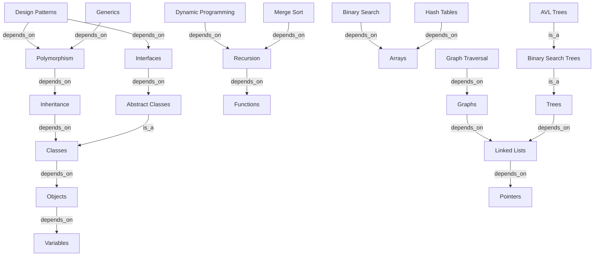

# Knowledge Graph

AxiomEngine models curriculum prerequisites using an in-memory directed graph. The graph governs local context extraction during adaptive plan generation, topological prerequisite ordering, and student cognitive state classification.

---

## Tuple Model

The knowledge graph models domain relationships as directed Subject-Relation-Object (SRO) triples represented by `domain.GraphTuple`:

```json
{
  "subject": "Polymorphism",
  "relation": "depends_on",
  "object": "Inheritance"
}
```

A directed edge originates at `subject` and terminates at `object`, labeled by `relation`.

### In-Memory Representation

The graph is loaded into `graph.InMemoryGraph` (`internal/graph/memory.go`), which indexes tuples across four structures:
- `forward: map[string][]domain.GraphTuple`: Outgoing edges indexed by `subject`.
- `reverse: map[string][]domain.GraphTuple`: Incoming edges indexed by `object`.
- `nodes: map[string]bool`: Complete set of all unique concept names.
- `all: []domain.GraphTuple`: Slice containing every unique tuple.

Once loaded during process startup, `InMemoryGraph` is immutable. Read operations (BFS subgraph extraction, DFS prerequisite traversal, and existence checks) run concurrently without mutex contention.

---

## Relations and Semantics

The graph supports two edge relations:

| Relation | Semantic Meaning | Prerequisite Behavior |
|---|---|---|
| `depends_on` | Strict conceptual prerequisite. The `subject` cannot be understood without prior knowledge of the `object`. | Traversed by `GetPrerequisiteChain` as an upstream dependency. |
| `is_a` | Taxonomic specialization. The `subject` is a specific subtype or implementation of the `object`. | Traversed by `GetPrerequisiteChain` identically to `depends_on`, ensuring foundational abstractions precede specializations. |

---

## Seed Graph Summary

When `GRAPH_FILE` is unset, AxiomEngine loads an embedded seed graph containing 20 triples across 23 computer science concepts defined in [internal/graph/seed.json](../internal/graph/seed.json).

### Seed Graph Topology



---

## GRAPH_FILE Format and Validation

Custom curricula can be loaded by setting the `GRAPH_FILE` environment variable to the path of a JSON file.

### Format Example

```json
[
  {
    "subject": "Merge Sort",
    "relation": "depends_on",
    "object": "Recursion"
  },
  {
    "subject": "Recursion",
    "relation": "depends_on",
    "object": "Functions"
  },
  {
    "subject": "Binary Search Trees",
    "relation": "is_a",
    "object": "Trees"
  }
]
```

### Validation Rules

The graph loader (`Decode` in `internal/graph/loader.go`) enforces the following validation checks at startup:

1. **Strict JSON Array Structure**: The payload must consist of a single top-level JSON array. Extraneous keys or multiple JSON documents trigger `graph must contain exactly one JSON array`.
2. **Disallowed Unknown Fields**: JSON objects containing keys other than `subject`, `relation`, or `object` are rejected.
3. **Non-Empty Content**: The file must contain at least one tuple (`graph must contain at least one tuple`).
4. **Non-Empty Fields**: After whitespace trimming, `subject`, `relation`, and `object` must all be non-empty strings (`tuple %d has an empty field`).
5. **Permitted Relations**: The `relation` field must strictly match either `"depends_on"` or `"is_a"` (`tuple %d has unsupported relation %q`).
6. **No Self Loops**: A tuple cannot reference the same concept as both subject and object. Violations trigger `tuple %d is a self loop`.
7. **Deduplication**: Repeated identical triples are deduplicated during decoding.

---

## Cognitive Shadow States

The `GET /api/v1/tutor/student/:student_id/cognitive-graph` endpoint evaluates a student's concept deficits against the knowledge graph to produce a filtered Cognitive Shadow Graph.

### State Definitions

| State | Condition | Meaning |
|---|---|---|
| `failed` | Concept is present in the `topics` query parameter. | Direct evidence of assessment failure. |
| `learning` | Concept is an upstream prerequisite of a failed concept (computed via `GetPrerequisiteChain`), but was not explicitly failed. | Latent prerequisite deficit requiring reinforcement. |
| `mastered` | Concept is present in the filtered connected subgraph with no failed assessment record or prerequisite deficit. | Presumed mastered or supporting concept. |

### Computation Algorithm

The shadow graph is generated by `GenerateCognitiveShadow` in `internal/graph/memory.go` through the following procedure:

1. **Populate Deficit Sets**:
   - `failedSet`: Hash set of all topics in `topics`.
   - `learningSet`: For each topic in `topics`, perform a post-order depth-first traversal (`GetPrerequisiteChain`) following outgoing `depends_on` and `is_a` edges. Add all discovered prerequisites that are not in `failedSet` to `learningSet`.
2. **Seed Selection**:
   - If `target_topic` is specified in the query parameters, set the BFS traversal seed to `[target_topic]`.
   - If `target_topic` is omitted, set the BFS traversal seeds to all `topics`.
3. **Depth-1 Local Subgraph Extraction**:
   - Run a breadth-first search (`GetLocalSubgraph(seeds, 1)`) following both forward and reverse edges to collect all direct relationships.
4. **Orphan Node Pruning**:
   - Only concepts that appear as either `source` or `target` in at least one edge in the depth-1 subgraph are retained in the `nodes` output. Disconnected concepts are pruned.
5. **State Assignment**:
   - For each connected node, determine `cognitive_state`:
     - If in `failedSet` -> `"failed"`.
     - Else if in `learningSet` -> `"learning"`.
     - Else -> `"mastered"`.
6. **Deterministic Output Sorting**:
   - Sort `nodes` alphabetically by `id`.
   - Sort `edges` lexicographically by `source`, `target`, and `relation`.
