# Knowledge Graph

AxiomEngine models curriculum prerequisites using an in-memory directed graph. The graph governs local context extraction during adaptive plan generation, topological prerequisite ordering, and student cognitive state classification.

---

## Tuple Model

The knowledge graph models domain relationships as directed Subject-Relation-Object (SRO) triples represented by `domain.GraphTuple`:

```json
{
  "subject": "Polymorphism",
  "relation": "depends_on",
  "object": "Inheritance"
}
```

A directed edge originates at `subject` and terminates at `object`, labeled by `relation`.

### In-Memory Representation

The graph is loaded into `graph.InMemoryGraph` (`internal/graph/memory.go`), which indexes tuples across five structures:
- `forward: map[string][]domain.GraphTuple`: Outgoing edges indexed by `subject`.
- `reverse: map[string][]domain.GraphTuple`: Incoming edges indexed by `object`.
- `nodes: map[string]bool`: Complete set of all unique concept names.
- `canonical: map[string]string`: Canonical representation (`internal/graph/canonical.go`) mapped to authoritative stored node name.
- `all: []domain.GraphTuple`: Slice containing every unique tuple.

Once loaded during process startup, `InMemoryGraph` is immutable. Read operations (BFS subgraph extraction, DFS prerequisite traversal, and existence checks) run concurrently without mutex contention.

---

## Relations and Semantics

The graph supports two edge relations:

| Relation | Semantic Meaning | Prerequisite Behavior |
|---|---|---|
| `depends_on` | Strict conceptual prerequisite. The `subject` cannot be understood without prior knowledge of the `object`. | Traversed by `GetPrerequisiteChain` as an upstream dependency. |
| `is_a` | Taxonomic specialization. The `subject` is a specific subtype or implementation of the `object`. | Traversed by `GetPrerequisiteChain` identically to `depends_on`, ensuring foundational abstractions precede specializations. |

---

## Node Naming

Concept node names in the knowledge graph are indexed canonically to support matching across casing, spacing, and Unicode representation differences.

After outer whitespace is trimmed, subject and object node names must be non-empty and at most 128 Unicode runes. Node names cannot contain commas, Unicode control characters (`unicode.Cc`), format characters (`unicode.Cf`), or the Unicode replacement character U+FFFD. Commas cannot be addressed as a single name because the cognitive-graph `topics` query parameter splits values on commas. Printable Unicode such as `Recursión` and `Straße` remains supported. Invalid UTF-8 sequences are rejected because `encoding/json` replaces invalid bytes with U+FFFD. Canonical request matching remains unchanged.

Canonical normalization (`internal/graph/canonical.go`) applies:
1. Removal of Unicode format characters (`unicode.Cf`).
2. Whitespace collapsing and trimming via `strings.Fields`.
3. Unicode case folding via `cases.Fold()`.
4. Unicode Normalization Form C (`norm.NFC`).

Distinct stored node names cannot share the same canonical form. During graph loading, the loader rejects any collision where two distinct node names produce an identical canonical key with `tuple %d has canonical node name collision: %q and %q`.

Original spellings, casing, and spacing of stored graph nodes are preserved in memory and returned in API responses.

---

## Querying Topics and Prerequisite Paths

`InMemoryGraph` provides methods for inspecting topics, direct neighbor relationships, and topological study paths:

- `Topics(filter string) []domain.Topic`: Returns all curriculum concepts sorted alphabetically by stored name. When `filter` is non-empty, matches topics whose canonical name contains the canonical filter string (`strings.Contains(Canonical(name), Canonical(filter))`). Each `domain.Topic` entry contains the stored `Name`, direct `Prerequisites`, and direct `Dependents`. If no concepts match, returns an empty slice.
- `Prerequisites(topic string) []string`: Returns a sorted, deduplicated slice of direct prerequisites for a concept, following outgoing edges from `forward` across both `depends_on` and `is_a` relations.
- `Dependents(topic string) []string`: Returns a sorted, deduplicated slice of direct dependents for a concept, following incoming edges from `reverse` across both `depends_on` and `is_a` relations.
- `Path(topic string) (domain.TopicPathResponse, bool)`: Resolves `topic` against canonical node names. If found, returns a `domain.TopicPathResponse` with `Topic` set to the stored name, `PrerequisiteChain` containing all transitive prerequisites in topological study order (excluding the requested concept itself), and `Dependents` containing direct dependents. Returns `false` if the concept is not found in the graph.

All querying methods return newly allocated defensive copies of topic and relationship slices, ensuring concurrent callers cannot mutate internal graph indices.

---

## Seed Graph Summary

When `GRAPH_FILE` is unset, AxiomEngine loads an embedded seed graph containing 20 triples across 23 computer science concepts defined in [internal/graph/seed.json](../internal/graph/seed.json).

The embedded seed curriculum structural summary:
- **Concepts**: 23 unique concept nodes.
- **Relations**: 20 total relations (17 `depends_on`, 3 `is_a`).
- **Roots**: `Arrays`, `Functions`, `Pointers`, `Variables`.
- **Longest Chain**: 6 concepts in topological study order: `Variables` → `Objects` → `Classes` → `Abstract Classes` → `Interfaces` → `Design Patterns`.

### Seed Graph Topology

In the visual legend, solid arrows mean “required before” and point from a prerequisite to the topic that needs it. Dashed arrows mean “has subtype” and point from a general topic to its subtype. Both relations are drawn in study order, pointing from the foundational concept to the dependent concept. This maps to the stored curriculum triples `(subject, relation, object)` where `subject` depends on or is a subtype of `object`: a stored `(A, depends_on, B)` tuple means B is required before A (drawn B → A), while a stored `(A, is_a, B)` tuple means B has subtype A (drawn B --▸ A).

The diagram groups the topics by connected component: Object-oriented, Graphs and trees, Algorithms, and Arrays and hashing, which holds Binary Search with Arrays and Hash Tables, its only prerequisite. Within a group, topics read left to right and downward in prerequisite order, and no arrow crosses a group border. Motion follows Variables → Objects → Classes → Abstract Classes → Interfaces → Design Patterns, then Pointers → Linked Lists → Trees → Binary Search Trees → AVL Trees, and pauses before repeating; with reduced motion the image is static.

<picture>
  <source media="(prefers-color-scheme: dark)" srcset="assets/diagrams/seed-graph-dark.svg">
  
</picture>

---

## GRAPH_FILE Format and Validation

Custom curricula can be loaded by setting the `GRAPH_FILE` environment variable to the path of a JSON file.

### Format Example

```json
[
  {
    "subject": "Merge Sort",
    "relation": "depends_on",
    "object": "Recursion"
  },
  {
    "subject": "Recursion",
    "relation": "depends_on",
    "object": "Functions"
  },
  {
    "subject": "Binary Search Trees",
    "relation": "is_a",
    "object": "Trees"
  }
]
```

### Validation Rules

The graph loader (`Decode` in `internal/graph/loader.go`) enforces the following validation checks at startup:

1. **Strict JSON Array Structure**: The payload must consist of a single top-level JSON array. Extraneous keys or multiple JSON documents trigger `graph must contain exactly one JSON array`.
2. **Disallowed Unknown Fields**: JSON objects containing keys other than `subject`, `relation`, or `object` are rejected.
3. **Non-Empty Content**: The file must contain at least one tuple (`graph must contain at least one tuple`).
4. **Non-Empty Fields**: After whitespace trimming, `subject`, `relation`, and `object` must all be non-empty strings (`tuple %d has an empty field`).
5. **Permitted Relations**: The `relation` field must strictly match either `"depends_on"` or `"is_a"` (`tuple %d has unsupported relation %q`).
6. **No Self Loops**: A tuple cannot reference the same concept as both subject and object. Violations trigger `tuple %d is a self loop`.
7. **Deduplication**: Repeated identical triples are deduplicated during decoding.
8. **Acyclic Prerequisite Structure**: Both `depends_on` and `is_a` edges must form a directed acyclic graph (DAG). Cyclic prerequisite dependencies are rejected at startup with `graph contains a prerequisite cycle: <path>` (for example, `graph contains a prerequisite cycle: B -> C -> B`). Traversal evaluates starting nodes in sorted order and rotates the cycle to its smallest node to report the path deterministically. Diagnostics show at most 16 nodes and truncate node names exceeding 64 runes with an ellipsis, reporting total node count when nodes are omitted.
9. **Canonical Node Name Uniqueness**: Distinct node names may not share the same canonical form. Canonical collisions are rejected at startup (see [Node Naming](#node-naming)).
10. **Addressable Node Names**: After outer whitespace is trimmed, subject and object node names must be at most 128 Unicode runes and must not contain commas, Unicode control characters (`unicode.Cc`), format characters (`unicode.Cf`), or the replacement character U+FFFD (including invalid UTF-8 sequences). Violations fail startup validation reporting the tuple index, field (`subject` or `object`), a quoted prefix of at most 64 runes, and the violated rule (`tuple %d subject %.64q contains a comma`, `contains a control character`, `contains a format character`, `contains a replacement character`, or `exceeds 128 runes`).

### Validating a Curriculum

The CLI provides a `validate-graph` subcommand to verify curriculum files without starting the HTTP or MCP server:

```sh
axiom-server validate-graph <file>
```

- **Execution**: Runs the startup loader (`graph.Load`) before configuration parsing. Requires no `AXIOM_INTERNAL_TOKEN`, AWS credentials, or model provider configuration.
- **Output**: On successful validation, writes a JSON summary object to standard output (`stdout`) and exits 0:
  - `concepts`: Total count of unique concept nodes.
  - `relations`: Object mapping each relation type (`depends_on`, `is_a`) to its occurrence count. Both `depends_on` and `is_a` edges count as prerequisite dependencies.
  - `roots`: Alphabetically sorted array of concept names that have no prerequisites (nodes with zero outgoing prerequisite edges).
  - `longest_chain`: Array of concept names representing one longest prerequisite chain in topological study order, ending with the concept that requires them. Ties between equal-length chains are resolved deterministically by sorted concept names.
- **Failure**: On validation failure, prints the loader error message to standard error (`stderr`) and exits with code 1.

Example output for the embedded seed:

```json
{"concepts":23,"relations":{"depends_on":17,"is_a":3},"roots":["Arrays","Functions","Pointers","Variables"],"longest_chain":["Variables","Objects","Classes","Abstract Classes","Interfaces","Design Patterns"]}
```

---

## Example Computer Science Curriculum

The repository ships an optional larger curriculum in [examples/graphs/computer-science.json](../examples/graphs/computer-science.json). It is also bundled into the runtime container image at `/usr/share/axiom-engine/graphs/computer-science.json`.

This curriculum covers six core subject areas:
- Programming fundamentals (variables, control structures, functions)
- Object-oriented programming (encapsulation, inheritance, polymorphism, design patterns)
- Data structures and algorithms (arrays, trees, graphs, sorting, dynamic programming)
- Databases (relational algebra, SQL, indexing, transactions, ACID properties)
- Operating systems (processes, threads, synchronization, memory management)
- Computer networking (OSI model, sockets, TCP, UDP, HTTP, HTTPS)

Curriculum summary:
- **Concepts**: 130 unique concept nodes.
- **Relations**: 173 total relations (154 `depends_on`, 19 `is_a`).
- **Roots**: `Number Systems`, `Sets`, `Variables`.
- **Longest Chain**: 12 concepts in topological study order: `Variables` → `Pointers` → `Memory Allocation` → `Operating Systems` → `Processes` → `Threads` → `Synchronization` → `Interprocess Communication` → `Sockets` → `TCP` → `HTTP` → `HTTPS`.

The embedded seed curriculum remains unchanged.

---

## Cognitive Shadow States

The `GET /api/v1/tutor/student/:student_id/cognitive-graph` endpoint evaluates a student's concept deficits against the knowledge graph to produce a filtered Cognitive Shadow Graph.

### State Definitions

| State | Condition | Meaning |
|---|---|---|
| `failed` | Concept is present in the `topics` query parameter. | Direct evidence of assessment failure. |
| `mastered` | Concept is present in the `mastered` query parameter (when learner history is supplied) or present in the filtered connected subgraph with no failed assessment record or prerequisite deficit (when learner history is omitted). | Explicitly mastered concept or presumed mastered supporting concept. |
| `learning` | Concept is an upstream prerequisite of a failed concept (computed via `GetPrerequisiteChain`), but was not explicitly failed or mastered. | Latent prerequisite deficit requiring reinforcement. |
| `unassessed` | Concept is present in the filtered connected subgraph with no failure, prerequisite, or mastery evidence when explicit learner history is provided. | Unassessed concept in local concept neighborhood. |

### Computation Algorithm

The shadow graph is generated by `GenerateCognitiveShadow` in `internal/graph/memory.go` through the following procedure:

1. **Populate Concept Sets**:
   - `failedSet`: Hash set of all topics in `topics`.
   - `masteredSet`: Hash set of all topics in `mastered` (when supplied).
   - `learningSet`: For each topic in `topics`, perform a post-order depth-first traversal (`GetPrerequisiteChain`) following outgoing `depends_on` and `is_a` edges. Add all discovered prerequisites that are not in `failedSet` to `learningSet`.
2. **Seed Selection**:
   - If `target_topic` is specified in the query parameters, set the BFS traversal seed to `[target_topic]`.
   - If `target_topic` is omitted, set the BFS traversal seeds to all `topics`.
3. **Depth-1 Local Subgraph Extraction**:
   - Run a breadth-first search (`GetLocalSubgraph(seeds, 1)`) following both forward and reverse edges to collect all direct relationships.
4. **Orphan Node Pruning**:
   - Only concepts that appear as either `source` or `target` in at least one edge in the depth-1 subgraph are retained in the `nodes` output. Disconnected concepts are pruned.
5. **State Assignment**:
   - When explicit learner history (`mastered`) is provided:
     - Precedence follows `failed` > `mastered` > `learning` > `unassessed`:
       - If in `failedSet` -> `"failed"`.
       - Else if in `masteredSet` -> `"mastered"`.
       - Else if in `learningSet` -> `"learning"`.
       - Else -> `"unassessed"`.
   - When learner history is omitted:
     - If in `failedSet` -> `"failed"`.
     - Else if in `learningSet` -> `"learning"`.
     - Else -> `"mastered"`.
6. **Deterministic Output Sorting**:
   - Sort `nodes` alphabetically by `id`.
   - Sort `edges` lexicographically by `source`, `target`, and `relation`.
